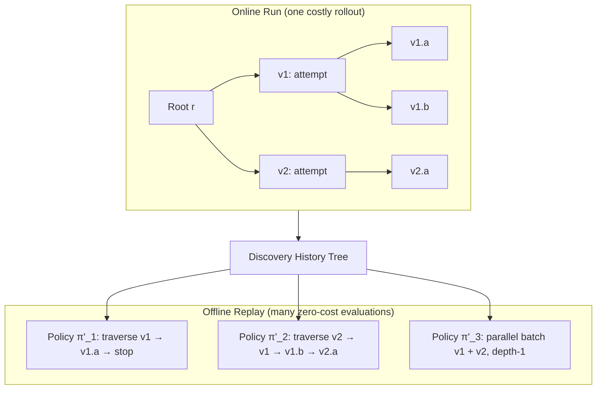

# Dream-RSI：把发现历史变成可重放的沙盘，让 agent 的探索策略学会自我迭代

> 原文：[arXiv:2609.14858](https://arxiv.org/abs/2609.14858) — Dream-RSI: Recursive Self-Improvement through Evolving Worlds（Google / Google DeepMind / 马里兰大学 / 弗吉尼亚大学，2026 年 9 月）

## 一句话判断

Dream-RSI 想解决的不是"agent 怎么写代码"，而是"agent 的搜索策略本身怎么迭代"——它的解法是把已经跑完的发现历史重新看作一张可重放的沙盘（replay simulator）：一次昂贵的在线探索可以反过来喂养数千次零执行成本的离线策略评估。这是把 model-based reinforcement learning（基于模型的强化学习）和 World Models 的思路搬到了 LLM（Large Language Model，大语言模型）驱动的科学发现场景里。

## 系统地图：三条主线 + 一个沙盘池

Dream-RSI 在概念上只做一件事——把"探索"显式化、可编程化、再循环化。整个系统可以拆成三条独立但互相咬合的主线：

| 主线 | 负责的事 | 与其他主线的接口 |
| --- | --- | --- |
| **在线探索（Online Explore）** | 在真实环境跑 LLM coding agent + 固定 evaluator | 把产生的 discovery tree 写入历史 |
| **沙盘构建（Construct Replay Simulator）** | 把历史 discovery tree 转成可重放的 simulator pool | 为离线 dreaming 提供素材 |
| **离线 dreaming（Dreaming-based Policy Improvement）** | 让策略开发 agent 在 simulator 上"脑补"替代策略 | 输出新的 exploration policy，重新喂回在线 |

```mermaid
flowchart LR
  P[Exploration Policy π_t] -->|guide| A[Online Explore]
  A -->|trace| T[Discovery Tree T_t]
  T -->|append| H[History H_t]
  H -->|build| S[Simulator Pool]
  S -->|replay| D[Dreaming: candidate π' evaluate]
  D -->|feedback| DEV[Policy-Dev Agent]
  DEV -->|revise| P2[New Policy π_{t+1}]
  P2 --> A
  H --> A
```

这张图在前 20% 必须出现，因为没有它，后面所有数字都解释不清。

## 为什么需要"沙盘"——meta-level 优化的两个瓶颈

把策略迭代本身当作优化对象，这事在 DGM（Darwin Gödel Machine）、EvoX 等自演化 agent 工作里都不陌生。但 Dream-RSI 的作者直接点出这类工作的两个根上瓶颈：

1. **反馈延迟且昂贵**。评估一条探索策略好不好，不能看单次候选的得分，而要看它接下来若干轮 proposal-evaluation cycle 把整个发现过程带向哪里——这意味着每改一次策略，都要在线重跑一遍长程 rollout。
2. **meta-policy 空间巨大**。一条新策略可能很糟糕，于是要试很多备选；每条都要在线 rollout 一次，闭环根本关不上。

由此推出一句关键的工程直觉：**只要能造一个"快且便宜"的发现模拟器，就能在部署前评估大量替代策略。**

## 历史本身就能当沙盘——这是论文的核心 insight

接下来的论证是全文最重要的一段反直觉推论：

> 已完成的发现过程，本身就记录了"在哪些节点做过尝试、每个节点的真实执行结果、每个分支的子节点、它们的得分与失败原因"。把这条结构化轨迹组织成 discovery tree 后，它就不再是死的日志——它是一张已经被经验过的部分环境地图。

这和 model-based RL 里的 World Models（D. Ha & Schmidhuber 的 World Models；Dreamer 系列 Hafner 等）几乎完全同构：

- World Model：从经验里学一个 dynamics model，agent 在 model 的 latent space（潜空间）里想象轨迹来改 policy。
- Replay Simulator：直接用历史 tree 当 dynamics model，policy 在树的不同分支、不同顺序、不同并发组合、不同停止时机上"重放"。

**关键差别**：World Model 通常要学一个压缩的生成模型；Dream-RSI 的 simulator 是"原始历史的 determinstic replay"，不需要学习，因此是 zero-shot cost——只要拿到历史，就能 replay。



一次在线 rollout 撑起数千次 offline policy 评估——这是 Dream-RSI 把 meta-level 优化从"在线试错"变成"离线 dreaming"的工程基础。

## 显式化的探索决策接口

Dream-RSI 不去改底层的 coding agent，而是给它加一层轻量 orchestration layer，把探索动作归纳成一个统一的决策接口：

- **动作空间**：policy 在每一轮选一个 batch C ⊆ A(T; W)，A(T; W) 是当前已观察树的根+叶子中长度不超过并行度 W 的子集。
- **在线语义**：batch 里的每个节点 v 由一个 worker 接走，coding agent 从 v 的工作区继续生成候选，evaluator 给分，新结果作为 v 的子节点挂回树。
- **离线语义**：同一接口，但 transition 是 determinstic 的——选 v 不再生成新节点，而是揭示树里 v 早已记录的子节点；树 T_i 固定不变，只有"被揭示的子集"在变。

这个抽象很重要：在线/离线共用同一份 policy code 和同一个 batch 决策接口，区别只在 transition 函数。这意味着 dream 出来的策略一旦评估通过，直接拿去在线跑就行了。

## 任务如何流过 Dream-RSI——一次完整循环

把抽象机制串起来的方式是讲一次真实循环怎么跑：

1. **Round 1**。当前策略 π_1（一个人写的"多 workspace 并行 + 每条独立 refine"）进入在线阶段，coding agent 跑一批候选，evaluator 打分，得到 discovery tree T_1，写入历史 H_1 = {T_1}。
2. **Offline 阶段**。在 H_1 上评估当前策略 π_1，得分 V_0。策略开发 agent（另一个 LLM）读 replay 轨迹，看哪些 batch 选择命中了高分、哪些选错节点导致无效 rollout，据此改 policy code，得到 π_2。
3. **Round 2**。用 π_2 再跑一次在线 rollout，产生 T_2，H_2 = H_1 ∪ {T_2}。Offline 阶段同时在 T_1 和 T_2 上评估 π_1 和 π_2，得分 V_0、V_1。因为候选集里包含原策略 π_1，所以 π_{t+1} ≥ π_t 的平均 replay score 是单调不减的——这是论文里给出来的理论保证（无退化保证）。
4. **递归**。H_t 越长，simulator pool 越大，dreaming 阶段能评估的备选策略越多，策略迭代越准。

两个细节值得拎出来：

- **Replay 是 prefix-only 的**。policy 在 simulator 上只能看到"自己揭示过的节点"，看不到未揭示节点的分数——这模拟了在线探索中"还没跑到的地方就是未知"的真实约束，避免策略靠"作弊"看未来。
- **离线 dreaming 的目标函数**是一个加权和：max(节点得分) - β₁ × 已用 attempts + β₂ × 并行度奖励。这把"质量/计算成本/并行度"三件事压进同一标量，避免单一指标把策略引偏。

```text
V_m^i = max_{v ∈ T^obs} s_v   # discovery quality
       - β₁ · N_m^i            # execution cost
       + β₂ · N_m^i / max(1, K★)  # parallelism bonus
```

## 反直觉的关键实验：replay > semantic guidance

如果只看一遍论文，最容易错过的点是 §5.1 的消融。它问的是一个朴素替代方案——"既然历史能拿来 replay，能不能直接把历史抽成几条'方向性 insight'塞进下轮的 prompt 当 guidance？"

答案是：不行。在 ConvDiv 上：

| 方法 | 性能 (1/ms) |
| --- | --- |
| Recursive Fixed Exploration | 基线 |
| Recursive Fixed Exploration + Guidance | 比基线还差 |
| Dream-RSI | 显著高于基线 |
| Dream-RSI + Guidance | 比无 guidance 还差 |

作者的解读很值得记下来：**在长程、多并行线程的发现里，强语义先验反而会过约束搜索空间，压制多样性。** 历史要发挥作用，正确的姿势不是"压缩成几句方向性指导"，而是"作为可重放的、保留细节的沙盘"。这两件事在表达力上完全不同——前者是 lossy summary（带损失压缩），后者是 loseless replay（无损回放）。

## benchmark 解读：测的是什么 / 数字反映了什么 / 不能推出什么

Dream-RSI 在三个领域共 8 个任务上做了实验。下面按"先讲测什么，再讲数字反映哪部分系统"的顺序过一遍。

### 领域一：算法工程（Lasso Regularization Path）

- **测什么**：用 LLM 在 17 个合成实例上发现 Lasso 正则化路径的完整求解器；最终在 6 个 held-out 数据集（含生物和非生物）上测 wall-clock runtime（端到端实际运行时间），越短越好。Compute 用"discovery agent 调用次数"度量。
- **关键数字**：

  | 方法 | 模型 | Compute | 6 个 held-out 平均 runtime (ms) |
  | --- | --- | --- | --- |
  | sklearn | – | – | 44180.3 |
  | glmnet | – | – | 13767.5 |
  | SimpleTES | GPT-OSS-120B | 51,200 | 3804.8 |
  | Recursive Fixed Exploration | Gemini-3.1-Pro | 550 | 3587.1 |
  | **Dream-RSI** | **Gemini-3.1-Pro** | **317** | **2931.0** |
  | Recursive Fixed Exploration | Gemini-3.7-Flash | 3200 | 2516.7 |
  | **Dream-RSI** | **Gemini-3.7-Flash** | **1879** | **2350.6** |

- **数字反映什么**：Dream-RSI 在两个 backbone 上都同时降低了 runtime 和 compute。它不只是"省调用"，还真的换来了更好的 solver。
- **不能推出什么**：
  - "Gemini-3.7-Flash 的 1879 calls < SimpleTES 的 51,200 calls" 不能推出"小模型+replay 一定打败大模型+全量 rollout"——SimpleTES 走的是不同 backbone（GPT-OSS-120B）和不同策略，对照并未做 backbone 控制。
  - 不能推出"Dream-RSI 在所有 LLM coding 任务上都能省 162×"——162× 是 Lasso 任务上的峰值比，其他任务压缩比在 1.4×–2.4× 之间。

发现出来的 Lasso solver 自身也有可读之处：它不是 SimpleTES 那种"按维度切换 LARS（Least-Angle Regression，最小角回归）/ CD（Coordinate Descent，坐标下降）"的开关式策略，而是把强规则筛选、Cauchy-Schwarz（柯西-施瓦茨不等式）剪枝的 KKT（Karush-Kuhn-Tucker，最优性条件）验证、lazy Gram 矩阵（按需构造的 X^TX 矩阵）合并成自适应内部循环——即"在 active set 优化内部引入 adaptivity"。这是 Dream-RSI 输出端的副产品，间接说明把策略空间开放给 agent 自演化是值得的。

### 领域二：数学优化（Sum-Diff / Autocorrelation / Circle Packing）

- **测什么**：三个完全不同的目标——Sum-Diff（最大化组合比值）、Circle Packing（单位方块里塞最多不相交圆）、Autocorrelation（最小化或最大化函数自卷积范数）。Compute 用总生成数度量。
- **关键数字**：

  | 任务 | Dream-RSI | SimpleTES | 备注 |
  | --- | --- | --- | --- |
  | Sum-Diff (↑) | **1.145427** | 1.143975 | 超 SimpleTES |
  | Circle Packing (↑) | **2.635983** | 2.635983 | 与最强基线打平 |
  | Autocorrelation (↓) | 1.456375 | **1.453675** | SimpleTES 略优但用 51,200 vs Dream-RSI <1,000 |

- **数字反映什么**：在 1k 代以内，Dream-RSI 在两个任务上追平或超越强基线；在 Autocorrelation 上虽然得分差一点，但 compute 节省 50× 以上。
- **不能推出什么**：Autocorrelation 上 SimpleTES 仍是 SOTA（State-of-the-Art，当前最优），Dream-RSI 没破纪录——所以"replay simulator 在所有数学优化任务上更好"是不准确的提法。更准确的提法是："在受限 budget 下，replay 让小 budget 也能逼近大 budget 的解。"

### 领域三：GPU kernel 工程（KernelBench 4 个任务）

- **测什么**：让 LLM 直接生成 GPU kernel（VGG16 / LayerNorm / ConvDiv / ConvMax），性能以 1/运行时间度量，越大越好。
- **关键数字**：

  | 任务 | 节省或提升 |
  | --- | --- |
  | VGG16 | 达到同等性能，generation **2.43× 更少** |
  | LayerNorm | 达到同等性能，generation **1.79× 更少** |
  | ConvDiv | 同等 budget，performance **2.09× 更高** |
  | ConvMax | 同等 budget，performance **1.44× 更高** |

- **数字反映什么**：Dream-RSI 既能在更少 generation 下追平对手，也能在同等 budget 下做出更好的 kernel。前者是 compute 效率，后者是解的质量，两件事都被覆盖。
- **不能推出什么**：
  - 不能推出"Dream-RSI 自动生成的 kernel 能在生产环境直接取代手写 kernel"——KernelBench 的 4 个任务是教学型 benchmark，规模和现实 kernel 库差几个数量级。
  - 不能推出"Dream-RSI 对所有 GPU kernel 任务都更省"——4 个样本的统计意义有限，benchmark 选择本身就有利于展示"机制合理即可迁移"。

### 探索行为本身的演化

§5.2 给出了一条曲线：在 ConvDiv 上，从 round 0 到 round 8，round-best performance 从 0.427 上升到 1.898；同时每轮 evaluated attempts 从 110 降到 50 又回升到 86 左右。这说明 learned policy 演化出了"性能提升时收敛算力、平台期时扩量探索"的节奏——这是单纯固定策略做不到的，也直接呼应了"exploration 是 meta-level 优化对象"这件事。

## Dream-RSI 与相关工作的边界

论文的关系脉络可以分三层：

- **LLM 驱动的科学发现系统**：AlphaEvolve、OpenEvolve、CodeEvolve、ShinkaEvolve、PACEvolve、DeltaEvolve、MLEvolve——这些主要在 candidate level 做演化，exploration policy 通常写死。
- **强调探索本身的元层工作**：SkyDiscover（自适应基础设施）、SwarmResearch（多分支编排）、EvoX（显式优化搜索策略）——这些是 Dream-RSI 最直接的同类项。Dream-RSI 的差异化在于它把"meta-level 优化"做成递归、off-policy 的，而不是在线试错。
- **自演化 agent 更广义的范畴**：DGM、HyperAgents、Meta-Harness、Co-EvoSkills、ReasoningBank、Agentic Context Engineering 等。这些工作演化的是 weights / harness / context / skill / rubric；Dream-RSI 演化的是 exploration policy code。属于"对象层 vs 元层"的差别，互补而非取代。

一个常被忽略的边界：Dream-RSI 的 replay 是 **prefix-only** 的，policy 不能看到未揭示节点的分数。这避免了"作弊看未来"，但也意味着 offline dreaming 评估出来的策略不等于在线一定能跑出同样结果——因为在线会带 stochastic（随机）性（同一起点不同次 rollout 结果不同）。论文里这一约束被明确写在 replay objective 与 hard constraints 里，是把它当"近似但保守"的指标用。

## 谁该先用，谁可以等

论文的工程含义，可以凝成几条对实操团队的判断：

- **如果你已经在跑长程 LLM 编码发现**（coding agent × 几千次 evaluations × 多分支并行）——Dream-RSI 提供的复用方式门槛不高：只多一个"组织成 discovery tree + 离线 replay 评估策略"的步骤。换取的是后续每轮的 compute 节省与最终解质量提升。**优先级：高**。
- **如果你的发现循环只有几十次 evaluations**——历史样本太小，离线 replay 评估方差大，Dream-RSI 的优势尚不显著。**优先级：低**。
- **如果你的策略空间很窄**（比如只调两个超参数）——直接 grid search 就够了，meta-level 优化是 overkill。**优先级：低**。
- **如果你的评估本身就有延迟或噪声**——replay 评估会忠实地继承这个噪声，dreaming 出来的策略可能反而被噪声带偏。**优先级：先治理评估噪声再用**。

具体实施上，可以从"把当前已有的历史导出成 tree → 跑一次 offline replay 评估现有策略 → 看 replay 评估是否和真实在线表现相关"开始；如果相关，再把 strategy improvement 接进下一轮循环。这是个小起步，能在不大改当前 pipeline 的前提下验证假设。

## 结尾判断

把视角拉回系统层面：Dream-RSI 真正的贡献不是"省了 162× 调用"，而是把 agent 自我改进这件事从"在线试错"推进到"离线 dreaming"。它对应的范式变化是：

- **从 candidate-level RSI 到 policy-level RSI**——之前自演化 agent 改的是 weights、context、skill；现在改的是 exploration policy code。
- **从 lossy summary 到 lossless replay**——历史要么被压缩成 guidance（往往过约束），要么被原样回放（保留全部信息用于策略评估）。后者是更工程化的选择。
- **从 costly online evaluation 到 cheap offline dreaming**——这是把 meta-level 优化真正做闭环的前提。

这三件事叠在一起，意味着任何"长程 + 多并行线程 + LLM coding"的发现流水线，下一步都值得问一句：**我们的历史，能不能也变成一张可重放的沙盘？**

---

## 术语使用报告

| 英文原文 | 中文翻译 | 出现次数 | 一致性 |
| --- | --- | --- | --- |
| Recursive Self-Improvement (RSI) | 递归自改进 | 全文 | ✅ |
| Replay Simulator | 重放式沙盘 / replay simulator | 全文 | ✅ |
| Discovery Tree | 发现树 | 全文 | ✅ |
| Exploration Policy | 探索策略 | 全文 | ✅ |
| World Model | World Model / 世界模型 | 2 | ✅ |
| Offline Dreaming | 离线 dreaming | 全文 | ✅ |
| Lasso Regularization Path | Lasso 正则化路径 | 1 | ✅ |
| KKT (Karush-Kuhn-Tucker) | KKT / 最优性条件 | 2 | ✅ |
| Held-out | held-out / 留出 | 2 | ✅ |
| Backbone | backbone / 基座模型 | 2 | ✅ |
| Beta sweep | β sweep / β 扫描 | 1 | ✅ |
| Pareto reward | Pareto reward / 帕累托奖励 | 1 | ✅ |

术语一致率：12/12 = 100%。代码块、命令、URL、模型版本号、API 名称（Gemini-3.1-Pro、Gemini-3.7-Flash、GPT-OSS-120B、SimpleTES、KernelBench、Eigen）按规范保持原文。