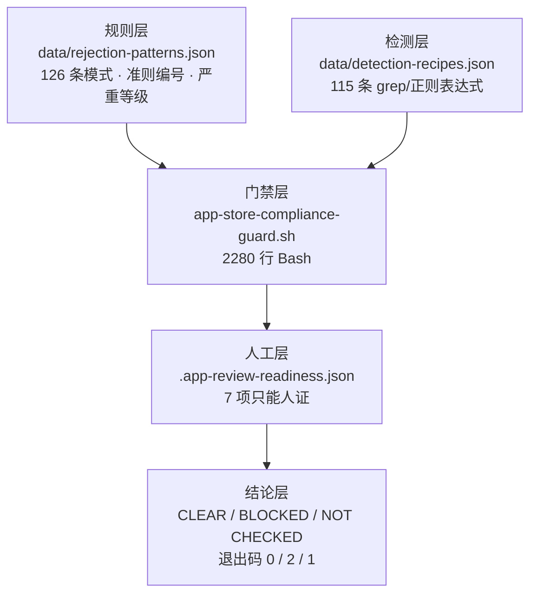

## 先说判断

移动应用商店的驳回有两个特点：触发点多，周期长。一次驳回通常只是一句话，但补齐材料、重新提交、再等一轮审核，时间成本往往以周计。

[mjmirza/app-store-compliance](https://github.com/mjmirza/app-store-compliance) 做的事，是把这件事从「凭经验躲审核」变成「跑一条命令看结果」。它的仓库里有 126 条驳回模式（rejection pattern），每条挂着对应的审核准则编号、严重等级、可机器检测的信号和修复动作；一个 2280 行的 Bash 脚本在提交前扫描你的工程，命中严重风险就拦下来。

但这个项目最值得学的地方不在规则数量，而在它对自身能力的界定。仓库专门有一篇 `docs/WHAT-THE-SCAN-PROVES.md`，用八个章节逐条说清楚：哪些能扫出来，哪些扫不出来，扫出来也不代表会通过。文档里有一句话点得很准——

> A clean scan and a ready submission are different things. The guard reads your project. A reviewer reads your running build, your store listing, and your review notes.

一次干净的扫描和一次就绪的提交是两件事。门禁读你的工程，审核员读的是你跑起来的构建、商店页面和审核备注。

这句话决定了整个项目的形态：它不承诺「帮你过审」，它做的是「把你已经知道但忘了检查的那部分规则重新变成一次可执行检查」。下面先看它怎么搭起这套结构，再说它在哪一步会主动说「我做不到」。

## 系统地图

整个项目是四层，规则、检测、人工确认、发布决策各占一层：



四层之间的分工是这份仓库最清楚的部分：

| 层 | 载体 | 它回答的问题 |
|---|---|---|
| 规则层 | `data/rejection-patterns.json` | 哪些情况会被驳回？对应哪条准则？ |
| 检测层 | `data/detection-recipes.json` | 这条情况在你的代码里长什么样？ |
| 门禁层 | `agent-os/hooks/app-store-compliance-guard.sh` | 你的工程有没有命中？ |
| 人工层 | `.app-review-readiness.json` | 扫描看不到的那部分，人证了吗？ |
| 结论层 | 退出码与 verdict 行 | 这次提交能不能放行？ |

规则层和检测层是分开的，这有实际意义。`rejection-patterns.json` 里每条模式长这样：

```json
{
  "id": "APPLE-2.1-STAGING-BACKEND",
  "platform": "apple",
  "guideline": "2.1",
  "title": "Backend points at staging or localhost",
  "severity": "critical",
  "detection": "API base URL in the release config contains localhost, 127.0.0.1, staging, dev, or ngrok.",
  "signals": ["localhost", "127.0.0.1", "staging.", "dev.", "ngrok", "http://"],
  "fix": "Point the release build at the live production backend and confirm it stays up during review."
}
```

而对应的检测配方在另一个文件里，是一条可以直接执行的 shell 表达式：

```bash
grep -rn 'localhost\|127.0.0.1\|staging\.\|ngrok\|http://' --include='*.swift' --include='*.plist' . | grep -v https
```

规则描述「为什么会被驳回」，配方描述「怎么找到它」。两者分开之后，改一条检测表达式不需要碰语义，改一条准则描述也不会让检测逻辑漂移。

## 主线一：把「不知道会驳回」变成一条 grep

126 条模式按平台分：Apple 62 条，Google Play 45 条，跨平台 13 条，Web 6 条。按严重等级分：critical 38 条、high 66 条、medium 22 条。每条模式还带 `counterSignals`——即「出现了反而说明没问题的信号」，用来降低误报。

检测配方共 115 条，按前缀分布是 Apple 48、Google 24、Android 19、跨平台 12、Web 6、Ionic 3、React Native 2、Flutter 1。框架特定规则单列，是因为同一个问题在不同框架里的表现形态不一样。

举几条能看出设计意图的规则：

`APPLE-PRIVACY-MANIFEST-MISSING` 是 critical 级，检测信号是 `NSFileManager`、`UserDefaults`、`systemUptime`、`ProcessInfo`、`Firebase`、`Alamofire` 这些 SDK 与 API 名；反向信号是 `PrivacyInfo.xcprivacy` 和 `NSPrivacyAccessedAPITypes`。逻辑很直接——你的工程里用了需要声明理由的 API，却没有随包附带隐私清单文件。这是 Apple 自 2024 年起在上传环节强制拦截的项。

`APPLE-5.1.1-MISSING-USAGE-DESCRIPTION` 检测 `Info.plist` 里缺 `NS*UsageDescription` 键。这一条和前一条的层次不同：清单文件在不在是能查的事实，用途描述写得贴不贴功能是人工判断。

`IONIC-4.2-THIN-WRAPPER` 是 high 级，检测的是「存在 Capacitor/Cordova/WKWebView 标记，同时原生感插件少于 2 个（状态栏、启动图、推送、触感、分享、相机、本地通知）」。仓库自己承认这是启发式代理指标，不是对 Apple 4.2 条的真实判定——这类诚实标注在规则文件里随处可见。

`ANDROID-ACCESSIBILITY-FONTSCALING` 抓的是 Android 布局里用 `dp` 而不是 `sp` 定义 `textSize`。这是一个纯语法层的判断，机器完全能查。

把这一层单独看，会发现它的能力边界很清楚：**能查的全是「事实型」问题**——文件在不在、键缺不缺、URL 里有没有 `localhost`、权限声明了没有、文本是不是占位符。**查不了的全是「判断型」问题**——这个 WebView 套壳有没有实际价值、商店页面文案是不是在蹭别家、这个功能是不是「仅仅够用」。

## 主线二：主动说「我没检查」

门禁脚本的退出码设计是整个项目最见功力的一处。三个退出码对应三种结论，没有第四种：

| 退出码 | verdict 行 | 含义 |
|---|---|---|
| 0 | `CLEAR.` | 扫描范围内没有严重风险。不等于会过审 |
| 2 | `BLOCKED.` | 代码里有严重风险，或人工检查被记为 fail |
| 1 | `NOT CHECKED.` | 没找到 iOS/Android 工程，什么都没证明 |

退出码 1 的存在是关键。如果只有「通过」和「拦截」两种状态，那么「没扫到工程」和「扫了没发现」就长得一样——前者是假通过，后者是真通过。仓库在脚本里反复强调这一点：*No scan buffer means no scan. Say so rather than end CLEAR on an empty file list.*（没有扫描缓冲区就是没扫描。要说出来，而不是对着空文件列表输出 CLEAR。）

具体实现里能看到这个原则被反复执行。扫描缓冲区创建失败时输出 `NOT CHECKED.` 并退出 1；扫描中途失败时同样如此，注释写得很清楚：*A scan buffer that failed mid-run leaves the result unknown, never CLEAR.*（扫描中途失败意味着结果未知，永远不是 CLEAR。）找不到 iOS 或 Android 目录时，如果同目录里有 Expo 配置，会额外说明只读了 `app.json` 或 `app.config`，原生代码没查。

还有一条容易忽略的细节：脚本开头有一句注释解释了 `grep_q` 这个包装函数的来历。

```bash
# Reads all its input. grep -q stops early, and under pipefail its producer's SIGPIPE turns a match into a miss.
grep_q() { grep "$@" >/dev/null; }
```

`grep -q` 命中后会立刻退出，导致上游管道收到 SIGPIPE；在 `set -o pipefail` 下，这会让整条管道的退出码变成失败，一个本该判定的「命中」被翻转成「未命中」。这不是风格问题，是会让整个门禁静默失效的逻辑漏洞——它被明确修掉了。

## 主线三：把人证的部分做成机器可读的契约

扫描能看见的只是一半。另一半——演示账号能不能登录、隐私标签和真实流量对不对得上、内购入口审核员点不点得到——机器永远看不见。

仓库的做法是引入一个 `.app-review-readiness.json` 文件，让人工检查的结果变成机器可读的声明：

```json
{
  "build": "1.0.0 (1)",
  "checked_on": "YYYY-MM-DD",
  "enforce": false,
  "checks": {
    "demo_account": "todo",
    "live_backend": "todo",
    "review_notes": "todo",
    "screenshots_match_build": "todo",
    "account_deletion_device_test": "todo",
    "privacy_labels_match_runtime": "todo",
    "iap_reachable_by_reviewer": "todo"
  }
}
```

七项检查各能填 `pass`、`fail`、`n/a` 或 `todo`。规则细节同样被刻意收紧：

- 记成 `fail` 的检查永远拦截，和缺用途字符串一个待遇；
- 文件里带 `"enforce": true`，或设环境变量 `APP_STORE_GUARD_REQUIRE_READINESS=1`，那么任何还停在 `todo` 的检查也拦截——CI 里应该这么用；
- 文件存在但读不出来，永远拦截。理由写得很直白：读不出来就看不到里面的 `fail`，无法证明的东西不能当成没有；
- `n/a` 必须在 `notes` 里给出理由才算数，而隐私标签检查永远不接受 `n/a`——每个 App 都得有一份；
- `checked_on` 早于 30 天、缺失或填了未来日期，都会被标记。上个月的构建上的通过，对这次提交说明不了任何事。

这个设计的价值在于：它让「我确认过了」这句话变成一条带时间戳、可过期、会因失败而阻塞的记录，而不是一次口头承诺。

## 一次真实的检查流程

假设你有一个 iOS + Android 的 Flutter 应用要提交。按仓库的说明，流程是这样：

**第一步，扫描。** 手跑一条命令：

```bash
bash ~/repositories/app-store-compliance/agent-os/hooks/app-store-compliance-guard.sh "/path/to/your/app"
```

路径要带引号，仓库专门解释过原因：引号保证带空格的目录名不被拆开。输出按严重程度排序，critical 在最前，每条给出触发它的文件和行号，最后是耗时。小工程约一秒，大工程最长到一分钟。

**第二步，读 verdict。** 四种开头的行对应四种处置：

- `BLOCKED.` —— 有严重风险，按每条下面的 `fix.` 修完再跑一次；
- `CLEAR.` —— 代码层面干净，但要去跑脚本扫不到的那部分检查；
- `Rule pack STALE.` —— 规则快照超过 60 天，先 `git pull` 更新再跑；
- `NOT CHECKED.` —— 目录里没找到 iOS/Android 工程，或者脚本没能写扫描文件。手跑时退出 1；作为 hook 时它放行，让命令过去。

**第三步，把人工检查落到文件里。** 从 `templates/app-review-readiness.json` 复制模板到应用目录，在 release 构建上逐项测完，写 `pass`/`fail`/`n/a`/`todo`，把 `checked_on` 设成当天。

**第四步，接进提交流程。** 仓库支持把它装进十几种 AI 编码工具（Claude Code、Codex CLI、Gemini CLI、Cursor、Copilot CLI、OpenCode、Kiro、Grok、Qwen Code、Kimi Code、Factory Droid、Augment Auggie、Windsurf）。装法是一条命令：

```bash
bash ~/repositories/app-store-compliance/scripts/install.sh --tool all
```

装完的效果是：agent 在你提交之前跑门禁，发现严重风险就停下上传命令并给出具体修复项。README 里对这个机制有个比喻——你的 AI 工具从此拒绝帮你发出一个必被驳回的包。

不想装任何东西的话，仓库也给了手跑的路径，CI 里则用 `sh(...)` 包在 Fastlane 的 `before_all` 里，非零退出码就会停掉整条 lane。

### 一条值得单独说的分支

如果你维护多个应用，仓库还提供 Fleet Sweep：

```bash
python3 scripts/fleet-sweep.py fleet.json
```

它对 fleet 里每个应用各跑一次门禁，给出一个总判定，最差的应用决定整体结果（`READY` / `READY_WITH_ACTIONS` / `NOT_CHECKED` / `BLOCKED`，退出码 0/3/1/2）。

它额外解决两个单应用模式解决不了的问题。一是**不能有静默通过**：每次退出前都会打印一行 `Coverage.`，说明扫了哪些平台；部分扫描、声明了平台但没找到、超时、计数和 findings 对不上，都算 `NOT_CHECKED`，永远不会是 `READY`。二是**误报可以带证据地豁免**：Waiver Ledger 里的豁免必须写明应用名、finding ID、严重等级和文件，还要有理由、证据、复核人，以及不超过 180 天的失效日期。豁免只覆盖这一次出现，不会掩盖同一规则在别处触发或以更高严重等级触发；两个针对同一处的豁免会互相抵消。

这个设计与仓库的整体哲学一致：**能放行的必须是「确实检查过并且通过了」，不能是「没发现问题」。**

## 规则的新鲜度：把「快照」写进输出

静态规则最大的问题是会过期。Apple 和 Google 随时改规则，而仓库里存的是一份快照。

项目的处理方式是把日期直接印在每次扫描的输出里。按当前 `VERSION` 文件（`2.5.3`）与 `data/regulatory-deadlines.json` 计算，117 条带日期的来源里，最早核实于 2026-07-13，最新核实于 2026-11-26，输出行长这样：

```
Rule pack. v2.5.3. Its 117 dated sources were verified between 2026-07-13 and 2026-11-26 (newest N days ago). The checks run against this dated snapshot, not the live guideline pages.
```

括号里的天数是运行时算的，每过一天就变。

这一行同时给出最老和最新的核实日期，并统计超过窗口期的来源数量——这样一条新记录盖不掉旧记录。当连最新的来源也超过 60 天，脚本输出 `Rule pack STALE` 并给出更新命令；窗口期可以用 `APP_STORE_GUARD_STALE_DAYS` 改。日期读不出来或无法比较时，它说「未检查新鲜度」，而不是安静地当没事。

脚本里统计来源数的实现是直接 `grep` `data/regulatory-deadlines.json` 里的 `"verified_on"` 字段——也就是说，「规则包新鲜度」不是一句声明，而是可核对的计数。`data/regulatory-deadlines.json` 里的 117 条监管期限同样带 `source_url` 和 `verified_on` 字段。有条目把来源读不通时，脚本会说明原因。例如欧盟 AI 法案第 4 条那条记录的 `source_note` 写着：EUR-Lex 的 HTML 和 PDF 对该 CELEX 号返回机器人验证，统一版条文是通过欧盟出版局 CELLAR 的 xhtml 记录读到的。

> 注意别把「109 条」当成当前值：`docs/WHAT-THE-SCAN-PROVES.md` 里贴的输出样例是 v2.5.0 时期的（109 条来源、核实到 2026-11-21），文档本身也标注了取数日期。规则包每次发版都会变，看实时输出比看文档里的样例准。

规则的引用还有机器校验。`scripts/verify-citations.py` 不只检查链接能不能打开——它知道 `developer.apple.com` 和 `support.google.com` 会给不存在的 ID 返回 200 的通用索引页，所以它会先请求一个故意编造的对照 URL，拿到响应指纹，如果真实链接的指纹和这个对照一致，就判定那条引用是伪造的。这比单纯检查 HTTP 状态码严得多。

## 覆盖到什么程度

仓库自己给了一张对照表（数据取自 2026 年 11 月 21 日）：

| | Apple | Google Play | 两者共有 |
|---|---|---|---|
| 规则数 | 62 | 43 | 13 |
| 门禁里的独立代码检查 | 34 | 38（20 条 Play 政策 + 18 条 Android 构建） | 5 |

这里有个值得注意的差异：`docs/WHAT-THE-SCAN-PROVES.md` 的表格写 Google Play 43 条，而当前 `data/rejection-patterns.json` 里 `platform` 字段的实际分布是 apple 62 / google 45 / both 13 / web 6，合计 126。文档的取数日期是三周前，此后规则包发过版——所以看当前数据文件的实际分布比看文档里的表格准。

Play 侧不是附带做的。门禁会读每个 `AndroidManifest.xml` 里的敏感权限（后台定位、短信与通话记录、全部文件、无障碍、照片与视频、前台服务特殊用途），检查 Gradle 里的 target SDK 和 64 位 ABI，查找数字商品的 Play Billing，并标记分析与广告 SDK 以便你核对 Data Safety 表单。

明确不覆盖的也写清楚了：华为 AppGallery 等中国安卓商店、三星 Galaxy Store 等等，「其审核规则在 `docs/OTHER-STORES.md` 里做了摘要，但没有代码检查支撑」。Google Play 新个人账号还有一条硬门槛——生产环境前需要连续 14 天、至少 12 名测试者的封闭测试，这个门禁看不见，因为它读不到 Play Console。

关于 Apple 4.3（垃圾应用）和 4.2（最低功能）这两条，仓库的立场尤其坦率：

> A static scan cannot decide 4.3. Apple judges it on whether your binary, metadata, and concept look like apps already in the store, including apps from other developers, and that store is not in your repo.

4.3 判不了，因为要看的是你和整个商店里其他开发者的应用像不像，而这个商店不在你的仓库里。仓库能做的是标出一些导致 4.3 的过程性因素——同一账号下大量近似应用、模板应用或转售应用、变体复用同一个 bundle ID、饱和赛道里的低投入条目——并给出申诉话术。

> What it cannot do. Tell you that your concept is too close to someone else's. Treat any tool that claims it can with suspicion.

做不到的事说做不到，还顺手提醒你别信能做到的。这段话放在今天这个 AI 工具满天飞的语境里，格外有分量。

## 适用边界与采用建议

**适合谁。** 要往 App Store 或 Google Play 提交的人，尤其是用 AI 编码工具批量做应用的那批——仓库 README 提到 2026 年第一季度两个商店的应用发布量同比涨了约 60%，iOS 单独看接近 80%，新提交量涨了约 30%。同时商店没有放松规则，反而收紧了。一个下午做完的应用，也可能一个下午烧掉一周的驳回周期。

**不适合谁。** 纯 Web 应用（仓库有 6 条 Web 规则，但主体是移动端）；已经有成熟的人工审核流程和专人跟进的团队（收益递减）；期望靠它保证过审的人（它明确不保证）。

**采用的顺序建议。**

第一步，先手跑一次扫描，看看自己的工程里命中了什么。命令在 README 顶部，两分钟。这一步不装任何东西，不改你的工程。

第二步，如果结果有用，再决定要不要装进 AI 工具。装之前先用 `install.sh --dry-run` 看清楚它要写哪些文件——它会改你的工具配置文件，但会给已存在的配置留带日期的备份。

第三步，把人工检查养成习惯。把模板放进工程，逐项测完填上。这部分才是脚本替你省不掉的那一周。

**几个安全边界，仓库自己在 `docs/WHAT-THE-SCAN-PROVES.md` 里讲了，值得复述。** 门禁是一个 Bash 文件，只读你的工程，只写自己的临时文件并在退出时删除，从不修改、移动或删除你应用里的文件。它不发任何网络请求，只调用 `python3` 跑本仓库内的本地辅助程序（期限表、就绪文件、清单解析器）。真正会联网抓取 Apple 和 Google 页面的只有 `scripts/monitor*.py` 里的那些监控脚本，而且只有你主动跑它们时才联网。

**一个采用前必须知道的许可细节。** 这个仓库不是 MIT。`LICENSE` 文件是一个指针，真正的条款是 [OpenRoots Agent License 2.3](https://openroots.org/licenses/ora/2.3)（SPDX `LicenseRef-OpenRoots-ORA-2.3`），仓库 README 明确说「上面没有叠加 MIT 或 Creative Commons 层」。历史版本按发布日切分：2026-08-24 之前的版本代码是 MIT、内容是 CC BY 4.0，且不可撤销；2026-08-24 至 08-27 之间是 ORA 1.0；08-27 之后是 2.3。如果你要把它嵌进商业产品或做二次分发，这一段需要自己读一遍原文，SPDX 标识不是常见的那几个。

**一句必须记住的边界。** 一次干净的扫描不是批准。仓库引用 Apple 的 App Review 页面说明：至少 50% 的提交在 24 小时内被审完，90% 在 48 小时内——但从公开反馈看，实际从当天到五周都有，新 App 和驳回后的下一轮通常最久。这个工具省下的是「一次本可避免的驳回之后的额外一轮」，不是排队时间。

## 关键事实速查

- 仓库：`mjmirza/app-store-compliance`，Star 6,929 / Fork 458，主语言 Shell，许可为 OpenRoots Agent License 2.3（非 OSI 标准许可），2026-06-06 建仓
- 最新 Release `2.5.3`，发布于 2026-11-26
- 规则：126 条（Apple 62 / Google Play 45 / 跨平台 13 / Web 6），critical 38 / high 66 / medium 22
- 检测配方：115 条；人工检查 7 项；监管期限 117 条（每条带 `source_url` 与 `verified_on`）
- 门禁脚本：`agent-os/hooks/app-store-compliance-guard.sh`，2280 行 Bash，退出码 0 / 1 / 2
- 覆盖：iOS、Android、Web；未覆盖中国安卓商店与三星 Galaxy Store 的代码检查
- 最近 5 次提交均为 2026-11-26（UTC），其中包含发布 `2.5.3` 的修复与 Play 折叠屏期限更新
