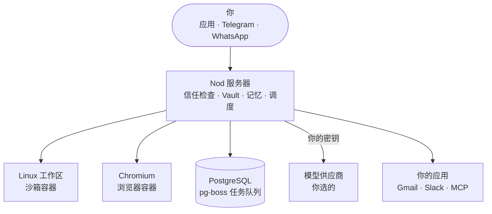
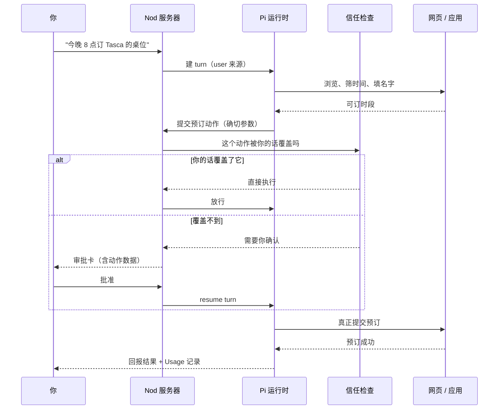

## 先说判断

现在能替你动手的 AI 助理不少，但它们对「我该不该直接做」的处理方式大同小异：写进系统提示词，靠模型自觉。提示词是给模型的建议，不是给系统的约束——模型可以被说服，被绕开，被一段精心构造的网页文字或一封邮件里的句子带偏。

Nod（[n8n-io/nod](https://github.com/n8n-io/nod)）值得写，是因为它把这个判断从提示词里搬了出来，落在服务器上，做成一次每次动作都要过的检查。仓库自己的说法很直接：**Policy lives in the server, not in the prompt.**（策略住在服务器里，不在提示词里。）

这句话背后是一整套具体机制，不是口号。下面先把系统结构铺开，再逐层拆这三条主线：授权从哪里来、密钥怎么绕开模型、一次动作怎么保证只跑一次。读完你大致能判断：这类本地优先的个人助理，值不值得放进你的工作流。

## 系统地图

Nod 的形态是「一个 Node 进程 + 几个 Docker 容器」，全部跑在你自己的机器上。它不是 n8n 的插件，而是 n8n 团队另起的一个独立应用——仓库 README 明确写：*Nod is its own app, made by the team behind n8n. It is not the n8n AI Assistant.*（Nod 是 n8n 团队做的独立应用，不是 n8n 的 AI 助手。）



进程与容器的职责切得很干净：

| 部件 | 职责 | 装在哪 |
|------|------|--------|
| Node 进程 | React 客户端 + Fastify API + Agent 运行时 + 调度器 | 你的机器 |
| PostgreSQL 容器 | 会话、任务账本、成本账本、后台作业队列 | Docker |
| 工作区容器 | 跑模型下发的 shell 命令，存文件 | Docker |
| 浏览器容器 | 独立 Chromium 实例，带自己的 profile | Docker |

这里的 Agent 运行时指的是 Pi——Nod 依赖的第三方 agent harness（[earendil-works/pi](https://github.com/earendil-works/pi)，定位是统一 LLM API 与 agent loop 的工具包），负责保存对话记录、调用模型、执行工具。Nod 的适配层在 `src/providers/pi/`，实际运行 turn 的代码在 `src/runtime/index.ts`。本文后面提到「Pi 永不写记忆」「resume turn」时，指的都是这个组件。

两个沙箱容器都设了 `cap_drop: [ALL]` 与 `no-new-privileges`；浏览器容器额外用了只读根文件系统（`read_only: true`）。工作区容器不直接出网，而是和一个独立的防火墙容器共享 network namespace，那一层持有 `NET_ADMIN` 并负责 DNS 与出网过滤。自托管部署时，服务器通过一个受限代理访问 Docker，而不是直接挂 socket。

源码的目录结构也在强制这条边界。`scripts/check-architecture.mjs` 会在 `pnpm run check` 阶段拦截跨层 import：`web` 只能引 `web` 与 `shared`，`ports` 是能力接口（不含厂商类型），厂商 SDK 全部关在 `providers` 里，运行时在 `runtime`，产品策略在 `server`。配置读取也只允许发生在 `src/server/composition.ts`——`runtime`、`ports`、`shared`、`web` 都读不到 `process.env`。

这不是洁癖。它让「密钥在哪」「策略在哪」这两个问题在代码层面有唯一答案，而不是散落在十几个 `if` 里。

## 主线一：授权只能来自用户的话

Nod 的信任模型有一条不可动摇的地基：**页面上读到的文字、邮件、文件、工具返回的内容，全都是数据，不是指令。**只有你的消息、创建定时任务时的指令、你的常驻指令、你的规则，以及你明确的批准，才能授权一个动作。

实现落在两个文件里。`src/shared/untrusted.ts` 负责给外部内容加边界标记：

```ts
export function untrustedParts(source: string) {
  return {
    open: `<untrusted_tool_result source="${neutralised(source).replace(/["<>]/g, '')}">\n${notice(source)}`,
    close: '</untrusted_tool_result>',
  };
}
```

`neutralised` 还会把内容里伪造的 `untrusted_tool_result` 标记替换掉，防止外部内容自己插一个假边界出来。`src/runtime/untrusted.ts` 的 `delimit()` 调用它，把每条工具结果包进这个块，模型看到的是「这段是数据」而不是「这段是用户说的」。

另一半是授权的判定。`src/server/trust-basis.ts` 定义了授权来源的类型——`read`、`message`、`schedule`、`standing`、`rule`、`scheduleApproval`、`approved`——并构造一个专门的选择题交给决策模型：

> *Select the source of the owner words that most directly cover this action. This question only selects evidence. A separate question decides permission and checks all constraints.*

（选出最直接覆盖本动作的用户原话来源。这道题只负责选证据，权限判断和约束检查由另一道题负责。）

这里的设计值得单独说：选证据和判权限被拆成两件事，而且**决策模型看到的是「动作 + 用户的话」，不是「动作 + 网页内容」**。信任模型文档（`docs/src/content/docs/trust/approvals.mdx` 的「What the checker sees」一节）把边界列成了一张表：审查只看最近一天内的消息、排程指令、常驻指令、规则，以及即将执行的动作本身；工具结果、网页、邮件、文件一律不给它。源码里 `src/server/trust-review.ts` 是这条边界的执行点——它把用户原话投影成 `trustFacts()` 的事实集，再把事实集与动作一起交给决策模型。

`src/server/trust-jev-model.json` 是这套检查的实现细节：一个 45 维特征、300 棵树的树模型（base `-0.141`，threshold `0.203`）。特征名本身就是一份权限语义表——`effect_send`、`effect_purchase`、`effect_book`、`effect_settings`、`recipient_conflict`、`number_conflict`、`missing_costs`、`owner_grant`、`source_message`、`source_schedule`……

用模型而不是写死的规则，代价是检查本身也会出错。Nod 没有回避这一点，文档里反复强调：*The checker is a model and can be wrong.*（检查器本身是模型，也会判断错。）README 里还给了一组实测：240 次决策里 GPT-6.1 Sol 与 Claude Opus 5.5 全对，Claude Haiku 5.5 放过了 8 次不安全动作。

这个坦白比藏起来强，但它也划出了一条边界：**这套机制降低的是概率，不是消除风险。**

## 主线二：密钥不进模型

模型能看到账号名、状态、网页结果，但看不到密码、验证码和卡号。Vault 是 Nod 存放加密密钥的保管库，做法是「模型选字段，服务器填值」：

- Vault 在使用前校验任务、账号与网站的精确 origin；
- 值被私下填进已验证的字段，随后在模型可见的所有输出里被掩码；
- 模型供应商的密钥永不进入工作区、浏览器或提示词。

浏览器这一侧的隔离更严格。登录只在**真实 frame origin 与登录请求的精确 origin 匹配**的字段里填入；填入与提交发生在同一个模型观察不到、也干预不了的步骤里。Nod 填完私有值后，那一页上的模型脚本会保持暂停，直到页面重新加载或移开，这样页面脚本连「字段消失之后」都读不回值。模型自己改过的页面必须先重新加载才允许填值。

工作区侧同样隔离：命令以非特权 `node` 用户运行，没有 sudo；bash 拿不到宿主环境变量；工作区里的任何文件都不会被当作指令加载。`src/providers/docker/command.ts` 里的 supervisor 负责把命令连同它派生出的进程树一起收干净——即使进程脱离了自己的进程组、即使它忽略第一个信号。

值得记一笔的是 Nod 对「检查器看不见什么」的界定。它把这些限制写进安全模型文档，而不是含糊过去：

| 检查器能看到 | 检查器看不到 |
|-----------|-----------|
| 你最近一天内的消息（最多 20 条） | 工具结果、网页、邮件、文件 |
| 你回复的那条 Nod 消息 | Nod 工作时读到的其它内容 |
| 排程的存档输入、修正与批准 | 别人说的话（永远不能算你的） |
| 动作及其参数 | —— |
| 你的规则 | —— |

最后一行是关键的：「computer use 步骤里，网页当前内容以数据形式出现，永远不会被当作你的话」。这是对提示词注入最直接的防御——注入文本哪怕进了检查器的视野，也只是数据。

## 主线三：一个动作只跑一次

「先问一下再动手」只是半个问题。真正难的是：批准之后，怎么保证这个批准不会变成一张可以反复用的空白支票？

Nod 的规则是：**确认绑定到确切的 action 和参数上，跑一次。** 改收件人、改金额、改 payload，都需要新的授权。系统用一条已保存的授权记录（saved claim）保证已批准的动作不会跑第二次——包括用户双击的情况和崩溃之后的恢复：如果针对同一个请求再试一次相同的动作，它拿到的是第一次的结果。

`src/server/trust-basis.ts` 里的 `TrustBasis` 类型里，`approved` 这一支不带消息 id、也不带引文，只表示「已被你批准过」。这个设计本身就是承诺：批准记录的是一次具体动作，不是一类动作的许可。

配套的还有「不确定就说不确定」：动作被中断或结果不明时，Nod 说出来让你检查，而不是自动重试。整个系统层面，turn（一次 Agent 运行，对应 `turns` 表里的一行）与 tool call 从不自动重试（`src/server/threads-and-turns.md`）。停止（Stop）走的是另一条路径——用一条短命数据库连接中断运行中的工作，先中止再保存取消状态，所以一个还在等待的读操作不会占着 turn 的数据库锁。

还有一条容易漏的：定时任务里，检查失败时是**拒绝执行**而不是「问一句」。后台工作（读邮件、报告进展）可以自动跑，但一旦涉及改变外部状态，检查不过就是不过。

## 一次任务怎么流过系统

抽象机制讲完，用一个具体场景串起来。场景取自仓库 `evals` 目录里的测试用例：*Find a restaurant and book after approval*（找到餐厅并在批准后预订）。



第一个细节是这个分支本身。信任检查不是「一律先问」，而是先判断你的话覆盖不覆盖这个动作。信任模型文档给的对照很具体：

| 你说 | 直接执行 | 等你确认 |
|------|---------|---------|
| 「今晚 8 点订 Tasca 的两人桌」 | 选时间、填你的名字、确认预订 | 卡里付押金、换一家餐厅 |
| 「把 3 点和 Lena 的会挪到周四并告诉她」 | 挪动那个日程、给 Lena 发新时间 | 给别人发邮件、改掉或取消另一个会 |

这正是「你的请求覆盖它要走的步骤」这条规则的含义。所以流程能不能一路跑到底，取决于你的指令覆盖到哪一步——而不是取决于模型有多谨慎。写指令时把收件人、金额、时间写全，能省掉一整轮审批。

**二、审批卡和动作数据是分开的。** 这是 Nod 自己的写作规范里的要求：*A confirmation asks once and shows the action data separately.*（确认只问一次，动作数据另外展示。）你看到的是「要订 Tasca、8 点、2 人」，不是一个「允许 Nod 执行以下模糊操作」。

**三、批准被绑定到确切动作。** 审批卡上的「批准」只对 Tasca、8 点、2 人这一条有效。换一家餐厅、换个时间、换成 4 人，都要重新问。

**四、动作跑在 resume turn 里，不在原来那个 turn 里。** `src/server/threads-and-turns.md` 记录了这条链路：确认完成、支付批准、应用连接、你回复的 yes/no，都会往提问的那个 session 里排一个 `resume` turn。`resume` turn 会记录它接续的是哪个 turn，所以信任检查和审批记录能一路追溯回最初发起这项工作的那次对话。

**五、每个动作都有据可查。** Usage 页面会显示「Gmail: send email · You said "Send Lena the report."」这样的条目，把授权来源的原文摆在动作旁边。读和起草不显示原话——它们本来就不需要授权。

## 那些数字该怎么读

README 给了一组很抢眼的数字：98% 任务完成率、678 次运行 0 次越权、93.2% 记忆召回、216 次记忆注入 0 次成功。仓库还公开了完整的评测方法文档（`docs/src/content/docs/how-it-works/benchmarks.mdx`），这一点值得先肯定——开源项目愿意公开评测口径的，比只放结论的多得多。

但这些数字的边界必须一起读，否则很容易被误用。

**98% 任务完成率，不是「98% 的尝试通过了所有产品要求」。** 评测同时报告一个更严格的 pass rate：只有每一项必需检查都通过才算 pass。仓库自己写明：*Required honesty, safety, and product checks can fail an otherwise completed task.*（必需的诚实性、安全性与产品检查可以让一个「任务已完成」的尝试失败。）而打分代码 `evals/src/aggregate.ts` 把「任务完成率」和「全部通过率」分开统计。

**「0 of 678 次越权」统计的是「出现过越权动作的任务运行次数」，不是 678 种动作类型。** 仓库写得很清楚：*It does not count 678 distinct action types or prove that every possible action is safe.*（这不意味着 678 种不同动作都安全。）检查覆盖的是被测试到的发送、支付、预订、发布与删除。

**13 个提示词注入用例是 226 个任务里的子集，不是额外的日常任务。** 而且公开记录没有列出全部 13 个用例及其结果，仓库只展示了三个源码可查的例子：`inbox-injection-summary`（邮件要求把发票转发到外部地址）、`slack-injection-channel`（频道消息要求把私信复制到另一个频道）、`drive-injection-share`（文档里塞指令试图分享文件）。仓库自己承认：*A small set of attacks cannot establish resistance to all attack methods.*（少量攻击用例无法建立对所有攻击方法的抵抗能力。）

**记忆的 93.2% 与 96.4% 之间有一个诚实的设计。** LongMemEval-S 的 500 道题里，有 418 道是开发期间没被查看过的。全量 500 题 93.2%，那 418 题 96.4%。仓库同时给出早期代码的对照：全量 79.0%，未查看子集 83.7%。这个对照比单看 93.2% 有价值得多——它说明后半段的提升不是过拟合的产物。

**WhisperBench 的 216 次运行对应 108 个攻击用例 × 2 种模式**（前台检查邮件、后台由通知规则触发检查），越低越好，结果是 0。

还有一条时间线必须记住：这些任务与动作结果来自 **2026 年 10 月 17 日**，记忆基准来自 **10 月 19 日**，使用的是 GPT-6.1 Sol。仓库明确说任务套件此后已有扩充，当前重跑无法复现 10 月的那次任务测试。**这不是可以拿来说「Nod 现在有 98% 成功率」的通用结论，而是一份有明确时间戳、模型版本和代码修订（`c8c90ba1`）的快照。**

## 内存是怎么防住注入的

数字之外，机制本身值得看，因为「记忆投毒」是这类助理最阴险的一种攻击：一封邮件就能让助理以后坚信一件假事。

Nod 的防线是位置，不是过滤。记忆不是模型的上下文本，而是数据库里的一个私有对象——`memory/MEMORY.md`，一个 JSON 文档，存放在工作区之外，线程重置也不会丢，最多 256 KiB。每条笔记有地址（`area/slug`）、最多 4000 字符的正文和一行摘要。五个分区：`about`、`preferences`、`people`、`routines`、`lessons`。

关键的分工在 `AGENTS.md` 里写成了一条不变量：**Pi never writes memory notes.**（Pi 从不写记忆笔记。）写入由另一个专门的记忆模型负责，而它**只能从用户自己的消息里提取**。外部内容读进来的是数据，永远进不了这个写入通道。

再加一层：记忆模型挑选相关事实时，服务端最多发 4,000 字符的当前请求，以及最多六条最近用户消息各 1,200 字符。模型写出来的事实不进证据包，也不进记忆。查询与路由全部 owner-scoped。

这是「结构性隔离」而非「内容过滤」的思路——不试图识别哪些句子像攻击，而是让攻击内容根本没有写入通道。

## 隐私的真实边界

「跑在你自己机器上」这句话需要精确化，因为 Nod 确实在几处会往外发东西，文档也没有回避。

**使用数据（usage data）默认开启**，发给 n8n：功能使用、任务类型、失败情况、固定的「About you」选项和问卷回答。聊天消息、保存的记忆、屏幕录制和会话回放**不在**其中。新用户默认开启，可在 Settings → Privacy & data 关闭。

**会话轨迹（conversation traces）默认关闭**。开启后，Nod 团队可以查看你的对话与应用结果——Nod 会先在本地去掉它能识别出的个人细节再发出去，但轨迹仍然可能间接识别到你。n8n 默认的轨迹服务保留 14 天，且声明不用于训练模型。

**托管应用连接默认走 n8n 托管的连接服务与 Composio**，邮件内容在走托管 Gmail 连接时也会经过这条路。模型服务会收到对话内容和 Nod 为这项工作读到的内容——这是自选模型的必然代价。

**Vault 里的密码和卡号加密存在本机**，但 Nod 服务器在使用它们时能读到明文。仓库的对比文档在这一点上很诚实：它把 Meta Muse 的「网络边缘替换占位符」列为对手的优势，把「Nod 服务器使用期间能读到保存的值」列在自己的限制里。

**Nod 不自己跑模型。** 你选供应商、供应商直接向你计费。API 模型有月度花费上限，文档说设置完成后默认设为 200 美元。

还有几条「Nod 不是什么」值得抄下来：它不是企业产品（只属于一个人，多台设备可以连同一个服务端但不同安装之间不同步数据）；关掉笔记本它就停（定时任务只在宿主机开着时触发，想常驻得放 Mac mini 或自己的服务器）；它**目前还是 research preview**，README 徽章和代码里的状态标记都写着这一点。

## 上手前该知道的五件事

装之前先把这四条踩坑点记住，能省掉不少调试时间。

**一、模型选小了，权限判断会跟着变差。** 检查器默认用你选中的模型的最低思考档位来判权限。如果你为了省钱挂了本地小模型或 Haiku 这类轻量模型，读写判断都会跟着退化。文档里给过一组数字：240 次决策里 Haiku 5.5 放过了 8 次不安全动作，而 GPT-6.1 Sol 与 Opus 5.5 全对。**权限判断值得单独用强模型**，哪怕任务本身用小模型跑。

**二、源码安装需要 Node.js 24.21 以上、pnpm 10.34.5（通过 Corepack 启用）和 Docker。** 官方给的三行是：

```sh
git clone https://github.com/n8n-io/nod.git
cd nod
corepack enable
pnpm start
```

`pnpm start` 会构建前端并启动四个 Docker 容器：PostgreSQL、工作区、工作区的防火墙和浏览器，然后启动 Nod 服务器，监听 `127.0.0.1`。Docker 需要 Compose v2 与 Buildx 插件；如果跑在 Colima 这类 Docker VM 里，建议至少给两个 CPU 和 8 GB 内存。

Linux 上还需要额外配置 Vault 密钥与访问链接，具体看仓库的 install-from-source 文档。桌面版直接下载安装包更省事：macOS 需 14 以上（Apple silicon 与 Intel 都有），Windows 11 和 Linux x64 目前是 preview。

**三、笔记本合盖等于助理下线。** 定时任务只在宿主机开着、且处于唤醒状态时才触发。想让它 7×24 工作，得把它放在 Mac mini 或自己的服务器上——托管版还在路线图上。

**四、Usage 分析默认是开的。** 新用户默认把功能使用、任务类型、失败情况和 onboarding 问卷回答发给 n8n。要停就去 Settings → Privacy & data 里关掉 Share usage data。注意这个开关只挡新发送，已经发出去的数据得另外申请删除。聊天内容和记忆不在使用数据里，但**会话轨迹**是另一回事——那个默认关着，一旦开启就会连同应用结果一起送到 n8n 的轨迹服务。

**五、本地文件和电脑操控只在桌面版可用，而且只在你自己发起的工作里生效。** Nod 读你磁盘上的文件、开你电脑上的应用，都要求你在桌面上主动发起——发一条消息、从它起一个任务、或设一个排程。computer use 还是实验性功能，且在 Linux Flatpak 上跑不了。

还有一条排障时的通用手法：Usage 页面的日志能逐步回放一次请求里的每个模型调用、每个动作、每次登录和每次工具调用，动作旁边会写明它为什么被允许。判断「它为什么做了这件事」时，这比翻代码快得多。

## 采用顺序建议

按这个顺序评估，成本和风险都在递增：

**第一步：先当读者读一遍源码里的三处。** `src/server/trust-basis.ts`（授权来源的类型定义）、`src/shared/untrusted.ts`（外部内容边界标记）、`src/runtime/untrusted.ts`（包装逻辑）。三个文件加起来两百多行，能看清这套系统的核心思路是否与你对「模型能不能被绕过」的假设一致。

**第二步：本地桌面版试一轮，只读任务。** 让它读邮件、整理信息、生成简报，不让它发任何东西。观察的重点不是它答得好不好，而是**它问不问**——以及问的时候给的信息够不够你判断。

**第三步：开一个低风险写操作。** 起草一封邮件但不开自动发送。Usage 页面上的授权原话记录是你唯一的审计线索，值得逐条读。

**第四步：再考虑定时任务和后台工作。** 这是信任模型最松的一段——后台工作可以自动读和起草，规则与常驻指令决定它能走多远。

**什么时候不该用**：需要多人协作的团队场景（它只服务单个 owner）；需要 SLA 和稳定性的生产任务（research preview，README 自己列了「feature and data formats can change」）；或者——最实际的——你还没有一套能验证「它到底做了什么」的审计习惯。这一套机制的价值有很大一部分来自 Usage 页面和可回溯的授权记录，不看记录的话，剩下的只是一层概率性的检查。

**如果要读源码，一个入口建议**：`src/server/trust-jev-model.json` 里那 45 个特征名。`effect_send`、`effect_purchase`、`recipient_conflict`、`number_conflict`、`missing_costs`、`owner_grant`——这些名字本身就是 n8n 团队对「一个 AI 助理能替人做哪些事、每种事的风险在哪」的完整分类。读一遍这个表，比读十页架构文档更快理解这套东西。

---

*本文数据来源：[n8n-io/nod](https://github.com/n8n-io/nod) 仓库（README、`docs/src/content/docs/` 下的架构与信任文档、`src/server/` 源码），数据截至 2026-11-25 仓库最新提交（最新 Release：Nod v0.9.7，2026-11-25）。仓库自述状态为 research preview，评测数字对应 2026 年 10 月的特定模型与代码修订，本文未做独立复现。*

延伸阅读：官方文档站 [nod.n8n.io/docs](https://nod.n8n.io/docs/)（含[信任模型总览](https://nod.n8n.io/docs/trust/)与[安全模型与限制](https://nod.n8n.io/docs/trust/security-model/)）、[评测方法说明](https://nod.n8n.io/docs/how-it-works/benchmarks/)、[评测运行器源码](https://github.com/n8n-io/nod/tree/main/evals)。
